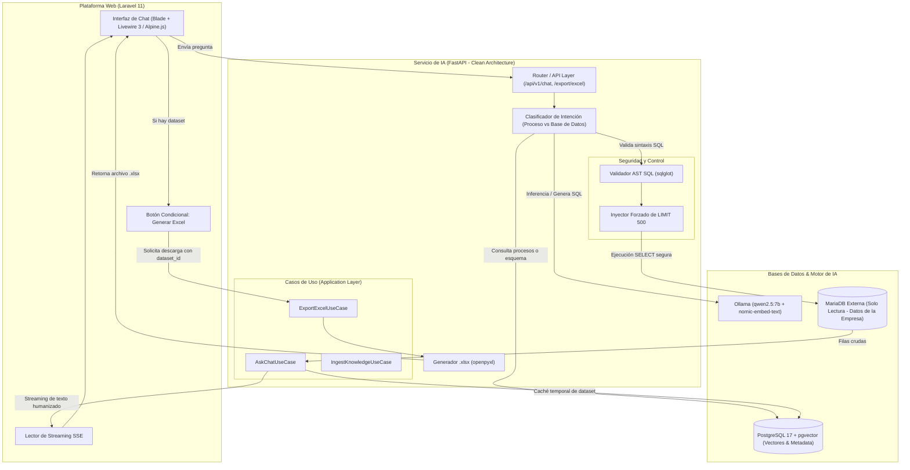

# 📋 PLAN GENERAL DEL PROYECTO: SERVICIO DE IA LOCAL, RAG CON PGVECTOR Y TEXT-TO-SQL MARIADB

> **Estado**: En Revisión  
> **Fecha**: Noviembre 2026  
> **Versión**: 1.0.0  
> **Ramas / Especificaciones**: Basado en `001-rag-core-service` (`.specify/` y `specs/001-rag-core-service/`)

---

## 1. Resumen Ejecutivo del Proyecto

El objetivo de este proyecto es construir un **asistente conversacional de inteligencia artificial** capaz de:
1. **Aprender sobre procesos empresariales** mediante la vectorización y almacenamiento de manuales, políticas y diccionarios de datos utilizando una **IA local** y **PostgreSQL con pgvector**.
2. **Consultar de manera segura y en tiempo real una base de datos externa en MariaDB**, extrayendo datos operativos de la empresa y traduciendo preguntas en lenguaje natural a consultas SQL validadas (Text-to-SQL).
3. **Ofrecer respuestas humanizadas y profesionales**, explicando los datos en un tono conversacional en español con formato Markdown estructurado y soporte de streaming en tiempo real (SSE).
4. **Permitir la descarga manual de reportes en Excel (.xlsx)**: Cuando una consulta retorne datos numéricos o tabulares, se mostrará al final de la respuesta un botón dedicado (`[ 📊 Generar Excel ]`), el cual generará al vuelo un libro de Excel con formato corporativo, cabeceras estilizadas y tipos de datos nativos.
5. **Arquitectura desacoplada en dos servicios**:
   - **Backend de IA (Python / FastAPI)**: Microservicio encargado de los modelos de IA, la base vectorial, los guardrails de SQL, la ingesta de documentos y la exportación de archivos Excel.
   - **Frontend / Cliente Web (DataMind Studio - Laravel 13)**: Aplicación web basada en [`https://github.com/ManriqueRecinos/datamind-studio.git`](https://github.com/ManriqueRecinos/datamind-studio.git), con arquitectura *Full Local (Offline Ready / Cero CDNs)*, Tailwind CSS v4, componentes nativos `<x-data-table>`, SweetAlert2, Toastr y Axios.

---

## 2. Diagnóstico del Entorno y Selección de IA Local

### 2.1 Hardware Detectado en tu Equipo
- **Procesador (CPU)**: Intel Core i5-14500T (14 núcleos: 6 Performance + 8 Efficient, 20 hilos).
- **Memoria RAM**: 16.0 GB DDR4/DDR5.
- **Gráficos (GPU)**: Intel UHD Graphics 770 integrada (memoria compartida, sin tarjeta NVIDIA dedicada).
- **Sistema Operativo**: Windows 11.

### 2.2 Motor de Inferencia Local: **Ollama**
- **¿Por qué Ollama?**:
  - Se ejecuta como ejecutable o servicio nativo en Windows.
  - Utiliza `llama.cpp` internamente, aprovechando instrucciones vectoriales de CPU **AVX2 / AVX-512**, lo que garantiza inferencia fluida en tu procesador Intel i5 de 14.ª generación.
  - Ofrece una API REST ligera y compatible con OpenAI en `http://127.0.0.1:11434`.
  - No requiere configuraciones complejas de Docker para la GPU.

### 2.3 Modelos Seleccionados (Optimizados para 16 GB de RAM)

| Rol | Modelo | Huella en RAM | Justificación |
| :--- | :--- | :--- | :--- |
| **LLM Principal (Chat & SQL)** | **`qwen2.5:3b`** (Instruct, Q4) | **~1.9 GB** | **Elección adoptada.** Ultra-liviano, velocidad de 30-45 tokens/s en tu CPU i5, excelente sintaxis SQL y redacción en español. |
| **LLM Alternativo (Mayor Capacidad)** | **`qwen2.5:7b`** (Instruct, Q4) | **~4.7 GB** | Variante de 7B disponible si se requiere mayor profundidad de razonamiento. |
| **Modelo de Embeddings** | **`nomic-embed-text`** | **~275 MB** | 768 dimensiones, ventana de contexto de 8,192 tokens. Genera vectores en menos de 50 ms en tu CPU. |

#### Comandos de instalación en Ollama:
```powershell
ollama pull qwen2.5:7b
ollama pull nomic-embed-text
```

---

## 3. Arquitectura del Sistema



---

## 4. Stack Tecnológico Detallado

### 4.1 Backend / Servicio de Inteligencia Artificial (Python)
- **Lenguaje**: Python 3.11+ (detectado Python 3.13 en tu sistema).
- **Framework Web**: `FastAPI` + `uvicorn[standard]` (asíncrono, soporte nativo de Server-Sent Events).
- **Validación y Configuración**: `pydantic` v2 y `pydantic-settings` (tipado estricto de extremo a extremo).
- **Acceso a PostgreSQL (Vectores)**: `SQLAlchemy 2.0` (asíncrono) + `asyncpg` + `pgvector-python`.
- **Acceso a MariaDB (Empresarial)**: `aiomysql` (conexión asíncrona no bloqueante).
- **Seguridad y Validación SQL**: `sqlglot` (análisis del árbol sintáctico abstracto para garantizar que solo se ejecuten sentencias `SELECT`).
- **Generación de Reportes Excel**: `openpyxl` (creación de hojas de cálculo con estilos, colores corporativos, filtros automáticos y tipos de datos formateados).
- **Cliente HTTP para Ollama**: `httpx` (asíncrono, para streaming de tokens y embeddings).
- **Testing**: `pytest`, `pytest-asyncio`, `pytest-mock`, `httpx`.

### 4.2 Base de Datos Vectorial y Memoria (PostgreSQL 17 + pgvector)
- **Motor**: PostgreSQL 17 (instalado en tu máquina en `C:\Program Files\PostgreSQL\17`).
- **Extensión**: `pgvector` (`vector(768)`).
- **Índice**: **HNSW (Hierarchical Navigable Small World)** con métrica de distancia coseno (`vector_cosine_ops`), permitiendo búsquedas de similitud en menos de 25 ms.
- **Búsqueda Híbrida**: Se combina la búsqueda semántica vectorial con búsqueda de texto completo (`tsvector` / `tsquery`) para que términos técnicos, nombres exactos de tablas o códigos de error se localicen con precisión quirúrgica.
- **Contenido Almacenado**:
  - Fragmentos de manuales de procesos de la empresa.
  - Diccionario del esquema de MariaDB (descripción de tablas, nombres de columnas, claves foráneas y comentarios explicativos).
  - Ejemplos de consultas SQL validadas previas (Few-Shot SQL).

### 4.3 Base de Datos Operativa Externa (MariaDB)
- **Rol**: Contiene los datos reales y de procesos de tu empresa.
- **Política de Seguridad**:
  - Conexión configurada con un usuario con permisos **únicamente de lectura (`SELECT`)**.
  - Validación previa de cada SQL generado mediante `sqlglot`: si la consulta contiene `INSERT`, `UPDATE`, `DELETE`, `DROP`, `ALTER`, `TRUNCATE` o ejecuciones de procedimientos, se cancela de inmediato antes de tocar la base de datos.
  - Inyección automática de cláusula `LIMIT 500` para evitar volcados masivos accidentales.
  - Timeout estricto de ejecución de 5 segundos.

### 4.4 Frontend / Plataforma Web (DataMind Studio - Laravel 13)
- **Repositorio Base Oficial**: [`https://github.com/ManriqueRecinos/datamind-studio.git`](https://github.com/ManriqueRecinos/datamind-studio.git)
- **Directorio Local en el Proyecto**: `datamind-studio/`
- **Versión de Plantilla**: `1.0.0`
- **Filosofía**: **Full Local (Offline Ready / Cero CDNs)** — Todas las fuentes (`webfonts/`), iconos (Font Awesome v7.x), CSS y scripts JS residen localmente en el repositorio sin requerir acceso a internet.
- **Núcleo Tecnológico**:
  - **Laravel Framework**: `^13.36` (PHP 8.3+ / 8.5+).
  - **Tailwind CSS**: `^4.0` con Vite 8 para diseño reactivo de alta velocidad.
  - **Axios (Minified Local)**: Cliente HTTP para consumir los endpoints REST y Server-Sent Events (SSE) del servicio de FastAPI.
  - **DataTables 1.13 + jQuery 3.6.0 (Local)**: Integrado a través del componente Blade `<x-data-table>`.
  - **SweetAlert2 v11.x & Toastr v2.x (Local)**: Alertas modales y notificaciones de confirmación para exportaciones y acciones de datos.
  - **Chart.js (UMD Local)**: Renderizado de gráficos analíticos embebidos en el chat para respuestas cuantitativas.
  - **Select2 v4.x (Local)**: Filtros instantáneos para departamentos y procesos.
- **Componente Blade `<x-data-table>` para Previsualización de Datos**:
  - En respuestas que extraen datos de MariaDB, la interfaz utiliza `<x-data-table>` para renderizar los registros con selector de longitud (`5`, `10`, `20`, `50`, `100`, `Todos`), altura constante con scroll suave interno (`scrollY="240px"`) y botón superior de exportación.
- **Regla Estricta de Versionado Semántico para Commits**:
  - Incremento decimal estricto: `1.0.0` ➔ `1.0.1` ... `1.0.9` ➔ `1.1.0` ➔ ... ➔ `1.2.0`.
- **Seguridad**:
  - Autenticación web de DataMind Studio, protección CSRF nativa y Token Bearer precompartido para comunicarse con FastAPI.

---

## 5. Dinámica de Funcionamiento del Chat y Generación de Excel

### Paso 1: Pregunta del Usuario en el Chat
El usuario escribe en la interfaz de Laravel:
> *"¿Cuáles son las órdenes del proceso de corte que tienen más de 3 horas de retraso actualmente?"*

### Paso 2: Análisis de Intención y RAG
1. FastAPI recibe la pregunta y determina que requiere datos cuantitativos de MariaDB.
2. Consulta en `pgvector` las tablas relevantes en MariaDB (recupera el esquema de `ordenes_proceso`).
3. Construye el prompt para Ollama (`qwen2.5:7b`) con el esquema y la pregunta.
4. Ollama genera la consulta:
   ```sql
   SELECT id_orden, codigo_proceso, horas_retraso, estado 
   FROM ordenes_proceso 
   WHERE codigo_proceso = 'CORTE' AND horas_retraso > 3.0 
   ORDER BY horas_retraso DESC;
   ```

### Paso 3: Guardrail de Seguridad y Ejecución en MariaDB
1. `sqlglot` inspecciona la consulta: confirma que es un único `SELECT` y agrega `LIMIT 500`.
2. Se ejecuta la consulta en MariaDB usando la conexión asíncrona de solo lectura.
3. Se obtienen, por ejemplo, 8 registros.

### Paso 4: Síntesis Humanizada y Registro de Datos
1. El LLM recibe las 8 filas y redacta una respuesta conversacional cálida y clara:
   > *"Actualmente se detectaron 8 órdenes en el proceso de corte con retrasos superiores a 3 horas. La orden con mayor demora es la #1042 con 6.2 horas acumuladas debido a mantenimiento de cuchillas..."*
2. FastAPI guarda los datos de las 8 filas en una tabla temporal de caché con un identificador único (ejemplo: `dataset_id = "ds_8a7b6c5d4e"`), con expiración de 2 horas.
3. La respuesta enviada a Laravel incluye:
   ```json
   {
     "message": "Actualmente se detectaron 8 órdenes...",
     "has_tabular_data": true,
     "dataset_id": "ds_8a7b6c5d4e",
     "row_count": 8
   }
   ```

### Paso 5: Experiencia de Usuario y Botón "Generar Excel"
1. En la pantalla del usuario en Laravel, el texto se escribe en tiempo real mediante streaming.
2. Al terminar la respuesta, la interfaz detecta `has_tabular_data: true` y muestra inmediatamente debajo:
   ```
   ┌──────────────────────────────────────────────────────────────┐
   │  📊 Descargar reporte en Excel (.xlsx) [8 registros]        │
   └──────────────────────────────────────────────────────────────┘
   ```
3. **Generación Manual Bajo Demanda**:
   - Si el usuario solo quería leer la respuesta, no se gasta tiempo ni memoria creando archivos.
   - Si el usuario hace clic en el botón, el navegador llama a:
     `GET /api/v1/export/excel/ds_8a7b6c5d4e`
   - Python toma las filas cacheadas, crea el archivo con `openpyxl`:
     - Título con membrete corporativo y fecha/hora de generación.
     - Columnas con fondo azul marino y texto blanco en negrita.
     - Ancho de columnas ajustado automáticamente.
     - Filtros automáticos en todas las cabeceras.
     - Formato numérico para los decimales de horas.
   - El archivo se descarga al instante como: `reporte_proceso_20261106_1515.xlsx`.

---

## 6. Estructura y Organización del Código (Clean Architecture)

El proyecto en Python seguirá una arquitectura limpia hexagonal para que la lógica de negocio nunca dependa de las librerías externas:

```text
python-db/
├── PLAN.md                          # Este documento maestro de revisión
├── specs/001-rag-core-service/      # Documentación y diseño SpecKit
│   ├── spec.md                      # Especificación funcional
│   ├── plan.md                      # Plan técnico detallado
│   ├── research.md                  # Justificación técnica de decisiones
│   ├── data-model.md                # Esquemas relacionales y de vectores
│   ├── quickstart.md                # Guía de pruebas de inicio rápido
│   └── contracts/                   # OpenAPI y contratos de streaming SSE
│       ├── chat-api.yaml
│       └── sse-events.md
│
├── app/                             # Código fuente del microservicio Python
│   ├── main.py                      # Punto de entrada FastAPI
│   ├── api/                         # Capa de Presentación (Controladores HTTP)
│   │   ├── dependencies.py          # Inyección de dependencias (Auth, Casos de uso)
│   │   ├── errors.py                # Manejo uniforme de excepciones
│   │   └── v1/
│   │       ├── api.py               # Router principal v1
│   │       └── routers/
│   │           ├── chat.py          # POST /chat y POST /chat/stream
│   │           ├── knowledge.py     # POST /knowledge/ingest y /schema-sync
│   │           └── export.py        # GET /export/excel/{dataset_id}
│   │
│   ├── core/                        # Configuración global
│   │   ├── config.py                # Variables de entorno con Pydantic Settings
│   │   └── logging.py               # Logs estructurados en JSON
│   │
│   ├── domain/                      # Capa de Dominio (CERO dependencias externas)
│   │   ├── entities.py              # DocumentChunk, ChatMessage, QueryDataset
│   │   └── interfaces.py            # Contratos de VectorStore, Database y LLM
│   │
│   ├── infrastructure/              # Capa de Infraestructura (Adaptadores)
│   │   ├── database/
│   │   │   ├── postgres_adapter.py  # Repositorio SQLAlchemy + asyncpg + pgvector
│   │   │   └── mariadb_adapter.py   # Conector aiomysql de solo lectura
│   │   ├── llm/
│   │   │   ├── ollama_adapter.py    # Cliente HTTP para Ollama (Qwen + nomic)
│   │   │   └── sql_guardrail.py     # Validador AST con sqlglot
│   │   ├── export/
│   │   │   └── excel_generator.py   # Generador de hojas .xlsx con openpyxl
│   │   └── parsers/
│   │       └── text_chunker.py      # Partición de documentos con solapamiento
│   │
│   └── use_cases/                   # Capa de Aplicación (Lógica de Negocio)
│       ├── ask_chat.py              # Orquestador del Chat (RAG + Text-to-SQL)
│       ├── ingest_knowledge.py      # Ingesta y vectorización de procesos
│       ├── sync_schema.py           # Sincronización del esquema de MariaDB
│       └── export_excel.py          # Recuperación de dataset y armado de Excel
│
└── tests/                           # Suite de Pruebas Automatizadas
    ├── unit/                        # Pruebas unitarias de guardrails y lógica
    ├── integration/                 # Pruebas de integración con pgvector y MariaDB
    └── contract/                    # Pruebas de endpoints FastAPI con httpx
```

---

## 7. Modelado de Datos (Tablas Clave en PostgreSQL)

1. **`knowledge_documents`**: Almacena los manuales de procesos originales, políticas y definiciones de tablas de MariaDB.
2. **`knowledge_vector_chunks`**: Fragmentos de texto indexados con columnas:
   - `chunk_text`: Texto del fragmento.
   - `embedding`: Columna `vector(768)` indexada con **HNSW**.
   - `tsv_content`: Columna `tsvector` para búsqueda de texto completo en español.
   - `metadata`: JSONB con etiquetas de departamento, paso de proceso o tabla asociada.
3. **`chat_sessions` & `chat_messages`**: Registro histórico de conversaciones por usuario de Laravel.
4. **`query_datasets`**: Tabla temporal de almacenamiento en caché para las consultas ejecutadas:
   - `dataset_id`: Token alfanumérico único.
   - `sql_executed`: La consulta exacta ejecutada en MariaDB.
   - `columns`: Metadatos de columnas.
   - `rows`: Filas en formato JSONB.
   - `expires_at`: Fecha de expiración (2 horas por defecto).

---

## 8. Contratos de la API (Resumen de Endpoints)

| Método | Endpoint | Descripción | Formato de Respuesta |
| :--- | :--- | :--- | :--- |
| **POST** | `/api/v1/chat` | Envía una pregunta y recibe la respuesta completa. | JSON con `message`, `has_tabular_data`, `dataset_id`. |
| **POST** | `/api/v1/chat/stream` | Envía una pregunta y transmite los tokens en tiempo real. | Server-Sent Events (`text/event-stream`). |
| **GET** | `/api/v1/export/excel/{dataset_id}` | Descarga manual del reporte en Excel del dataset asociado. | Archivo binario `.xlsx` (`application/vnd.openxmlformats...`). |
| **POST** | `/api/v1/knowledge/ingest` | Registra y vectoriza un nuevo manual de procesos en pgvector. | JSON con confirmación y número de fragmentos creados. |
| **POST** | `/api/v1/knowledge/schema-sync` | Sincroniza la estructura de tablas y comentarios de MariaDB. | JSON con las tablas indexadas en la base vectorial. |
| **GET** | `/health` | Chequeo de salud del servicio, conexión a PostgreSQL y a Ollama. | JSON `{ "status": "healthy", "ollama": "ok", "pgvector": "ok" }`. |

---

## 9. Buenas Prácticas y Calidad de Código Incorporadas

- **Aislamiento de Responsabilidades (SRP / Clean Architecture)**: El endpoint de FastAPI no sabe cómo funciona Ollama ni cómo se calcula un embedding; solo delega al caso de uso. Si mañana se desea cambiar Ollama por otro motor, únicamente se modifica el adaptador en `infrastructure/llm/`.
- **Tipado Fuerte (Pydantic V2)**: Cada solicitud, respuesta, evento de streaming y configuración tiene modelos estrictamente validados.
- **Asincronismo Total**: FastAPI, asyncpg, aiomysql y httpx trabajan sobre el bucle de eventos (`async def`), permitiendo múltiples usuarios simultáneos sin congelar el servidor.
- **Prevención de Inyecciones y Fallos**:
  - MariaDB se consulta únicamente con credenciales de lectura.
  - El validador `sqlglot` rechaza cualquier comando fuera de `SELECT`.
  - El límite forzado `LIMIT 500` previene desbordamientos de memoria.
- **Eficiencia de Recursos**:
  - El Excel solo se construye si el usuario hace clic deliberadamente en el botón.
  - La memoria de los datasets expira automáticamente.

---

## 10. Checklist de Aprobación

Revisa los siguientes puntos para confirmar que estamos alineados:

- [x] **IA Local**: Ollama con `qwen2.5:7b` (inferencia) y `nomic-embed-text` (embeddings) adaptado a 16 GB de RAM y CPU Intel i5.
- [x] **Base Vectorial**: PostgreSQL 17 nativo con extensión `pgvector` e índice HNSW para aprender procesos y esquemas.
- [x] **Base de Datos Externa**: MariaDB conectada en solo lectura, protegida por análisis AST con `sqlglot` y límites de filas.
- [x] **Stack de Lenguajes**: Python (FastAPI) para el servicio inteligente + DataMind Studio (Laravel 13, Tailwind CSS v4, `<x-data-table>`, Full Local / Cero CDNs).
- [x] **Chat y Respuestas**: Respuestas en lenguaje natural, humanizadas y profesionales en español, con streaming SSE.
- [x] **Exportación a Excel**: Botón manual al final de la respuesta para descargar el dataset con diseño empresarial en `.xlsx`.
- [x] **Mantenibilidad y Arquitectura**: Clean Architecture, separación en capas, pruebas automatizadas y contratos OpenAPI.

---

> 💡 **¿Todo en orden?**  
> Cuando confirmes que el contenido de este plan cubre exactamente lo que necesitas, podemos pasar a la siguiente fase: generar el desglose ordenado de tareas (**`tasks.md`**) para comenzar la implementación paso a paso.