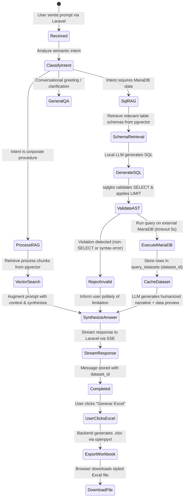

# Data Model: AI Chat Service with Local LLM, pgvector & MariaDB (001-rag-core-service)

## 1. Domain Entities & Storage Schemas

### 1.1 Knowledge Documents (`knowledge_documents`)
Stores source corporate documentation, process manuals, policies, and MariaDB data dictionaries before chunking.

| Field | Type | Constraints | Description |
| :--- | :--- | :--- | :--- |
| `id` | UUID | Primary Key, Default `gen_random_uuid()` | Unique document identifier |
| `title` | VARCHAR(255) | NOT NULL | Human-readable title of process or manual |
| `category` | VARCHAR(50) | NOT NULL, Indexed | `process_manual`, `policy`, `db_schema`, `custom_relation`, `business_rule`, `kpi_formula`, `sql_example` |
| `department` | VARCHAR(100) | NOT NULL, Indexed | Department owning the process (e.g., `Logística`, `Ventas`) |
| `content` | TEXT | NOT NULL | Full source text |
| `metadata` | JSONB | NOT NULL, Default `'{}'` | Arbitrary structured metadata (version, author, related_tables) |
| `created_at` | TIMESTAMPTZ | NOT NULL, Default `NOW()` | Ingestion timestamp |
| `updated_at` | TIMESTAMPTZ | NOT NULL, Default `NOW()` | Last modification timestamp |

---

### 1.2 Vector Chunks (`knowledge_vector_chunks`)
Stores partitioned text chunks and corresponding 768-dimensional embeddings generated by `nomic-embed-text`.

| Field | Type | Constraints | Description |
| :--- | :--- | :--- | :--- |
| `id` | UUID | Primary Key, Default `gen_random_uuid()` | Unique chunk identifier |
| `document_id` | UUID | Foreign Key -> `knowledge_documents.id` ON DELETE CASCADE | Parent document reference |
| `chunk_index` | INTEGER | NOT NULL | Order of the chunk in the document |
| `chunk_text` | TEXT | NOT NULL | Textual slice (typically 400-800 characters with overlap) |
| `embedding` | VECTOR(768) | NOT NULL | 768-dimensional embedding from local model |
| `metadata` | JSONB | NOT NULL, Default `'{}'` | Fast filtering payload (`{"table": "ordenes", "step": 3}`) |
| `tsv_content` | TSVECTOR | Generated ALWAYS AS `to_tsvector('spanish', chunk_text)` | Full-text search column for hybrid retrieval |

**Indexes**:
- `CREATE INDEX idx_vector_chunks_hnsw ON knowledge_vector_chunks USING hnsw (embedding vector_cosine_ops) WITH (m = 16, ef_construction = 64);`
- `CREATE INDEX idx_vector_chunks_tsv ON knowledge_vector_chunks USING gin (tsv_content);`
- `CREATE INDEX idx_vector_chunks_doc_id ON knowledge_vector_chunks (document_id);`

---

### 1.3 Chat Sessions & Messages (`chat_sessions`, `chat_messages`)
Maintains conversational history for multi-turn context and auditing.

#### `chat_sessions`
| Field | Type | Constraints | Description |
| :--- | :--- | :--- | :--- |
| `id` | UUID | Primary Key, Default `gen_random_uuid()` | Session identifier |
| `user_id` | VARCHAR(100) | NOT NULL, Indexed | User identifier from Laravel authentication |
| `title` | VARCHAR(255) | NOT NULL | Conversation title generated from first prompt |
| `created_at` | TIMESTAMPTZ | NOT NULL, Default `NOW()` | Creation timestamp |
| `updated_at` | TIMESTAMPTZ | NOT NULL, Default `NOW()` | Last active timestamp |

#### `chat_messages`
| Field | Type | Constraints | Description |
| :--- | :--- | :--- | :--- |
| `id` | UUID | Primary Key, Default `gen_random_uuid()` | Message identifier |
| `session_id` | UUID | Foreign Key -> `chat_sessions.id` ON DELETE CASCADE | Parent session |
| `role` | VARCHAR(20) | NOT NULL | `user`, `assistant`, or `system` |
| `content` | TEXT | NOT NULL | Message body (Markdown supported) |
| `intent` | VARCHAR(50) | NULL | `process_qa`, `data_query`, `general_chat`, `teach_knowledge` |
| `generated_sql` | TEXT | NULL | Cleaned, validated SQL query executed (if applicable) |
| `dataset_id` | VARCHAR(64) | NULL, Indexed | Reference to cached tabular data for Excel generation |
| `latency_ms` | INTEGER | NULL | Total processing time in milliseconds |
| `created_at` | TIMESTAMPTZ | NOT NULL, Default `NOW()` | Message timestamp |

---

### 1.4 Tabular Dataset Cache (`query_datasets`)
Ephemeral cache storing structured rows returned by MariaDB queries, allowing the user to trigger an Excel download on demand without re-querying the database or re-running the LLM.

| Field | Type | Constraints | Description |
| :--- | :--- | :--- | :--- |
| `dataset_id` | VARCHAR(64) | Primary Key (e.g. `ds_a8b9c0d1e2f3`) | Unique token passed to UI |
| `session_id` | UUID | Foreign Key -> `chat_sessions.id` | Associated chat session |
| `sql_executed` | TEXT | NOT NULL | The verified SQL statement that produced this data |
| `columns` | JSONB | NOT NULL | Column metadata: `[{"name": "id", "type": "int", "label": "ID"}]` |
| `rows` | JSONB | NOT NULL | Array of row data: `[{"id": 101, "proceso": "Empaque", "retraso_horas": 4.5}]` |
| `row_count` | INTEGER | NOT NULL | Number of rows returned (capped at 500) |
| `created_at` | TIMESTAMPTZ | NOT NULL, Default `NOW()` | Timestamp |
| `expires_at` | TIMESTAMPTZ | NOT NULL | Expiration timestamp (e.g., `NOW() + INTERVAL '2 hours'`) |

---

## 2. MariaDB Target Schema Mapping (External Reference)

The external business database in MariaDB is modeled read-only. A dedicated schema dictionary is mirrored into PostgreSQL `knowledge_documents` under `category='db_schema'`:

```json
{
  "table_name": "ordenes_proceso",
  "description": "Registro operativo de órdenes en línea de producción y sus fases de control de calidad",
  "primary_key": "id_orden",
  "columns": [
    {"name": "id_orden", "type": "INT", "comment": "Identificador único de orden"},
    {"name": "codigo_proceso", "type": "VARCHAR(20)", "comment": "Código del proceso (e.g., CORTE, ENSAMBLE, EMPAQUE)"},
    {"name": "estado", "type": "ENUM('PENDIENTE','EN_PROCESO','COMPLETADO','RECHAZADO')", "comment": "Estado actual"},
    {"name": "fecha_inicio", "type": "DATETIME", "comment": "Fecha y hora de inicio de operación"},
    {"name": "fecha_fin", "type": "DATETIME", "comment": "Fecha y hora de finalización o NULL si activa"},
    {"name": "horas_retraso", "type": "DECIMAL(5,2)", "comment": "Cálculo de desviación respecto al tiempo estándar"}
  ]
}
```

---

## 3. State Transitions & Lifecycle

### 3.1 Chat Execution Lifecycle
