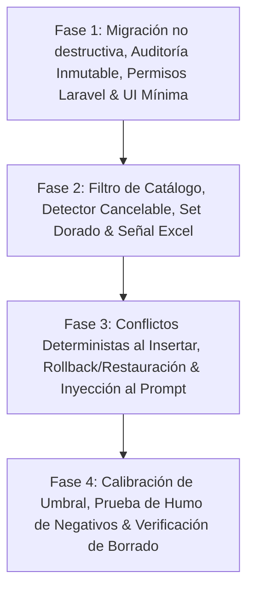

# Implementation Plan: Implicit Dialogue Learning & Candidate Lifecycle

**Branch**: `003-implicit-dialogue-learning` | **Feature**: `specs/003-implicit-dialogue-learning`

---

## 1. Technical Context & Stack Decisions

- **Framework**: FastAPI (async, `BackgroundTasks` con sesión de base de datos dedicada e independiente de la petición HTTP).
- **Base de Datos**: PostgreSQL 17 + `pgvector` (tabla `knowledge_vector_chunks` con DEFAULTs temporales para backfill no destructivo y CHECKs finales; `knowledge_audit_logs` desacoplada con trigger anti-mutación).
- **Validación AST**: `sqlglot` para validar que `prescriptive_condition` sea estrictamente una expresión booleana sobre la columna objetivo ($\le 250$ caracteres).
- **Control de Concurrencia**: Contador de inferencias en vuelo en memoria compartida, tope de 120 tokens en el detector y cancelación activa de la conexión a Ollama cuando entra una nueva pregunta.
- **Filtro Previo**: Requiere SQL previo en el asistente y coincidencia léxica con tablas/columnas de `synced_tables`.
- **Conflictos Deterministas**: Reglas con tupla `(connection_id, target_entity, target_column)` y condición normalizada diferente nacen con `status = 'conflict'`.
- **Frontend / Permisos**: Laravel 12 con migración para permiso `manage-knowledge` y vistas Blade con escapado obligatorio `e()`.

---

## 2. Fases de Implementación Reordenadas

### Fase 1: Migración, Auditoría, Permisos y UI Mínima
1. **Migración en PostgreSQL**:
   - `knowledge_vector_chunks`: añadir columnas con DEFAULT temporal (`verified`, `global`, `manual_teach`), backfill de filas históricas, DROP DEFAULT y aplicar `CHECK constraints`.
   - Añadir índice único condicional `(source_message_id, trigger_signal)` con cláusula `ON CONFLICT DO NOTHING` en la inserción.
   - Crear tabla inmutable `knowledge_audit_logs` (sin FK a `chat_sessions`, `rule_id` desacoplado) y trigger PostgreSQL anti `UPDATE`/`DELETE`.
   - Crear vista `v_knowledge_candidates_stats` referenciando `created_at`.
2. **Roles y Permisos en Laravel**:
   - Migración de seeders en Laravel para registrar el permiso `manage-knowledge` asignado a `super-admin` y `admin`.
3. **Endpoints de Ciclo de Vida en FastAPI**:
   - `GET /api/v1/knowledge/candidates` (con soporte para `proposed_only=true`).
   - `POST /api/v1/knowledge/candidates/{id}/confirm-user` (actualiza `confirmed_at`).
   - `POST /api/v1/knowledge/candidates/{id}/propose-global` (actualiza `proposed_global_at`).
   - `POST /api/v1/knowledge/candidates/{id}/promote-global` (solo admin, re-sanitiza, re-vectoriza e incrementa versión).
   - `POST /api/v1/knowledge/candidates/{id}/reject` (valida scope global restringido a admin).
   - `POST /api/v1/knowledge/candidates/{id}/rollback` (valida scope global restringido a admin, restaura `previous_state` o pasa a `rolled_back`).
4. **UI en Laravel 12**:
   - Componentes Blade con escapado estricto `e()` de títulos y contenidos para mitigar XSS.
   - Chip interactivo de confirmación y postulación.

### Fase 2: Filtro de Catálogo, Detector Cancelable y Señal de Servidor
1. **Set Dorado y Prueba de Humo**:
   - Archivo `tests/fixtures/golden_dialogue_corrections.json` con 30 casos en español (positivos y negativos para prueba de humo de cero falsos positivos).
2. **Filtro Previo Inteligente**:
   - Validar que el turno anterior del asistente contenga SQL generado.
   - Validar que el mensaje del usuario contenga palabras exactas coincidentes con tablas o columnas de `synced_tables`.
3. **Detector con Cancelación Activa de Ollama**:
   - Ejecución en background con tope de 120 tokens de salida.
   - Verificación de contador de inferencias en vuelo: si llega una nueva petición de usuario, cerrar activamente la conexión HTTP hacia Ollama.
   - Validación de `prescriptive_condition` con `sqlglot` (expresión booleana, solo columna objetivo, $\le 250$ chars).
   - Formateo de regla mediante plantilla estructurada y redacción de datos personales/sensibles.
4. **Señal de Servidor en Exportación**:
   - En `GET /chat/export/excel`, validar propiedad del dataset y extraer SQL con `sqlglot` para insertar candidato `sql_example` con `ON CONFLICT DO NOTHING`.

### Fase 3: Conflictos, Rollback con Restauración e Inyección al Prompt
1. **Conflictos Deterministas al Insertar**:
   - Búsqueda previa por `(connection_id, target_entity, target_column)`. Si la condición normalizada en AST difiere, la regla nace con `status: 'conflict'`.
   - Resolución entre candidatos del mismo usuario: confirmar la nueva regla marca la anterior como `rolled_back`.
2. **Rollback con Restauración**:
   - Reversión fiel desde `previous_state` en `knowledge_audit_logs` con re-vectorización.
3. **Inyección en Prompt y Persistencia de Metadatos**:
   - Búsqueda híbrida aislada y delimitadores estrictos `<<<DIRECTIVAS_APRENDIDAS>>> ... <<<FIN_DIRECTIVAS>>>`.
   - Persistir `rules_applied` en `chat_messages.metadata` y devolverlo en `GET /chat/sessions/{id}` para sobrevivir a la hidratación.

### Fase 4: Calibración, Humo y Borrado Limpio
1. **Prueba de Humo de Negativos**:
   - Verificar 0% de falsos positivos en frases negativas del Set Dorado.
2. **Calibración de Umbral**:
   - Calibrar umbral de `nomic-embed-text` con prefijos `search_document: ` y `search_query: ` usando un set independiente de pares consulta-regla.
3. **Prueba de Borrado de Sesión**:
   - Borrar sesión con candidatos y auditorías existentes; verificar que no falla y que la auditoría permanece intacta.
