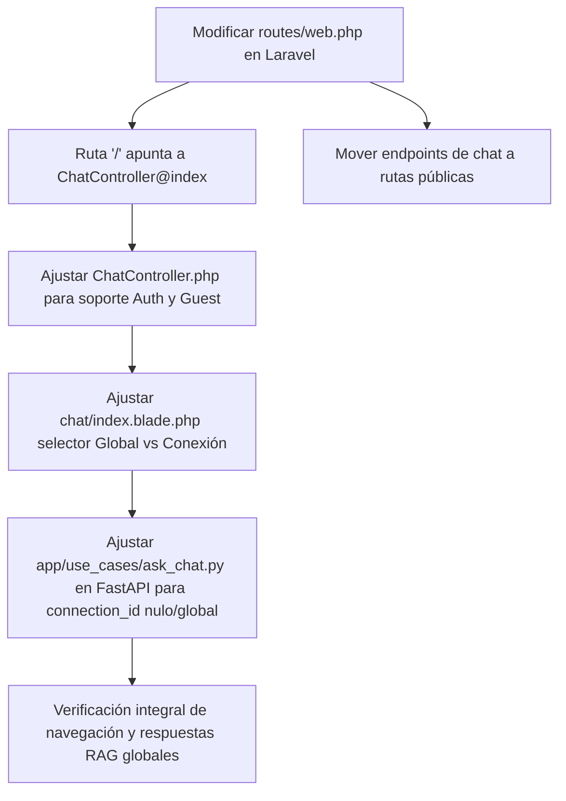

# Implementation Plan: 009-public-chat-global-knowledge

## 1. Technical Context & Architecture
- **Laravel (Supertex AI)**:
  - Rutas web (`routes/web.php`):
    - `Route::get('/', [ChatController::class, 'index'])->name('home');` (Punto de entrada directo).
    - Liberar las rutas de consulta y streaming del chat (`/chat`, `/chat/send`, `/chat/stream`, `/chat/dataset/{id}`) fuera del middleware `auth` para permitir interactuar como invitado (`guest_user`).
    - Las rutas privadas (historial persistente, sesiones guardadas, delete session, subida de archivos) mantendrán soporte autenticado.
    - El Hub de selección de ecosistemas se mantendrá protegido en `/hub`.
  - Vista del Chat (`resources/views/chat/index.blade.php`):
    - Adaptar el selector de base de datos `#activeConnectionSelect`:
      - Si `Auth::guest()`: Fijar en *"Conocimiento Global / Todas las Bases"* (deshabilitado o informativo). Botón en el header para *"Iniciar Sesión para consultar bases específicas"*.
      - Si `Auth::check()`: Mostrar opción *"Conocimiento Global"* + listado de conexiones registradas (`SUMAIE`, etc.).
  - Navbar y Layout (`resources/views/layouts/app.blade.php`):
    - Asegurar que renderice correctamente el navbar sin fallar si `Auth::user()` es nulo (renderizando botón "Iniciar Sesión").

- **FastAPI / Python (python-db)**:
  - `app/use_cases/ask_chat.py`:
    - En caso de que `connection_id` sea `None` o `'global'` o no se especifique:
      - Ejecutar búsqueda RAG transversal: documentos ingeridos (`knowledge_documents`), reglas aprendidas (`knowledge_rules`), y resúmenes de esquemas vectorizados de todas las bases sin anclarse a un adaptador SQL de una sola base.
      - Si el intent clasificado es conceptual/RAG, responder de inmediato con la síntesis del conocimiento global.
      - Si el intent fuera una consulta que requiere ejecutar SQL forzoso contra tablas vivas pero no hay `connection_id`, guiar amablemente al usuario indicándole que para consultar datos vivos de una base particular inicie sesión o seleccione una base activa.

## 2. Work Breakdown & Dependencies

## 3. Risk Assessment & Verification
- **Riesgo**: Que llamadas sin sesión en Laravel fallen al intentar acceder a `Auth::id()` o permisos.
  - *Mitigación*: `ChatController` ya tiene `resolveUserId()` que retorna `'guest_user'` cuando `Auth::check()` es falso.
- **Riesgo**: Que FastAPI intente hacer `manage_connections.get_connection(None)`.
  - *Mitigación*: Proteger las llamadas a conexión con un condicional estricto `if connection_id and connection_id != 'global':`.
