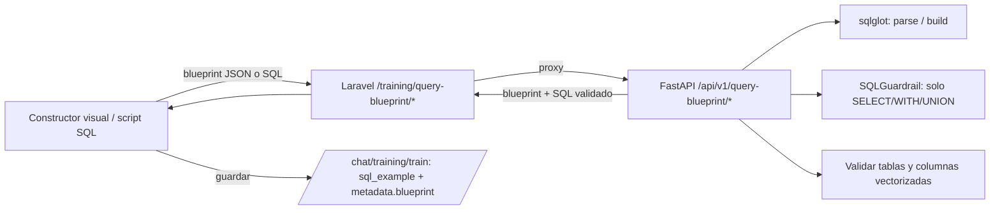

# Implementation Plan: 011-guided-join-rule-selectors

## Hallazgos del código actual
- `GET /api/v1/connections` ya devuelve `synced_tables` (lista de nombres vectorizados) → la lista paginada de tablas **no requiere introspección**: se pagina en Laravel sobre ese arreglo.
- Las columnas/FK solo salen de `GET /api/v1/connections/{id}/tables` (introspección completa, pesada). Se llamará **una vez por conexión y se cacheará** (10 min); cada selector de columnas se sirve desde esa caché.
- Formulario: campos de texto `#trainSourceTable`, `#trainSourceCol`, `#trainTargetTable`, `#trainLabelCol` en `resources/views/training/index.blade.php`, lógica en `public/js/training_view.js` (y duplicada en `training_manager.js` + modal `chat/partials/training-center-modal.blade.php`). El payload `source_table/source_column/target_table/label_column` no cambia → **FastAPI intacto**.

## Cambios (solo Laravel / Supertex AI)
1. **`TrainingController`** (2 métodos nuevos, rutas bajo `training.`):
   - `vectorizedTables(Request)` → `GET /training/vectorized-tables?connection_id&page&per_page=10&search`: toma `synced_tables` de la conexión, filtra por nombre (contiene, case-insensitive), pagina de 10 en 10, devuelve `{data:[{table_name}], page, has_more, total}`.
   - `tableColumns(Request)` → `GET /training/vectorized-tables/columns?connection_id&table`: lee la respuesta cacheada de `getConnectionTables` (`Cache::remember("training.tables.{id}", 600, …)`), devuelve `{columns:[{name,type,is_fk,references}], primary_key, label_suggestion}`; 404 claro si la tabla no está vectorizada.
2. **`routes/web.php`**: ambas rutas en el grupo `training` (solo lectura; protegidas igual que el resto de `/training`).
3. **Componente JS compartido `public/js/table_picker.js`**: selector con búsqueda (debounce 300 ms), lista de 10, botón "Cargar más", estados cargando/vacío/error. Usado por Tabla Origen y Tabla Maestra.
4. **Vista `training/index.blade.php`**: sustituir los 4 `<input>` por: picker de Tabla Origen, `<select>` de Columna Foránea (deshabilitado hasta elegir tabla), picker de Tabla Maestra, `<select>` de Campo Legible. Mantener los mismos `id` para no tocar la lógica de guardado.
5. **`training_view.js`**: encadenar eventos (origen → columnas; columna con FK → preselecciona maestra y su PK; maestra → columnas legibles con `name/nombre/descripcion` preseleccionado); reset total de los selectores tras guardar y al cambiar de conexión; validar los 4 valores antes de enviar.
6. **Modal heredado** (`training-center-modal` + `training_manager.js`): reutilizar el mismo componente para no tener dos formularios distintos.

## Verificación
- Pest/PHPUnit (o `php artisan route:list` + peticiones reales): paginación (página 1 = 10, página 3 = 8 de 28), búsqueda solo por nombre, tabla no vectorizada → 404.
- Prueba manual con SUMAIE: `role_user` → columna `role_id` → sugiere `roles`; guardar crea la regla `custom_relation` igual que hoy.

## Riesgos
- Primera carga de columnas lenta (introspección remota): mitigado con caché y spinner; invalidar caché al vectorizar/editar la conexión.
- `synced_tables` puede venir con minúsculas/schema; normalizar al comparar.
- Sin tablas vectorizadas: mostrar enlace a `/connections/explorer`.

---

# FASE 2: Constructor de Consultas Grandes (spec §7)

## Decisión de arquitectura
El parseo y la compilación de SQL viven en **FastAPI** (ya tiene `sqlglot 30.x` y `SQLGuardrail`); Laravel solo hace de proxy autenticado y de interfaz. Así hay **una sola fuente de verdad** del SQL y no se reimplementa un parser en PHP/JS.



## Modelo `query_blueprint` (JSON)
```json
{
  "type": "select",
  "base": {"table": "users", "alias": "u"},
  "joins": [{"type": "LEFT", "table": "role_user", "alias": "ru", "on": [{"left": "u.id", "op": "=", "right": "ru.user_id"}]}],
  "select": [{"expr": "u.name", "alias": "usuario"}, {"expr": "COUNT(*)", "alias": "total", "agg": true}],
  "where": [{"left": "u.active", "op": "=", "value": 1, "logic": "AND"}],
  "group_by": ["u.name"], "order_by": [{"expr": "total", "dir": "DESC"}], "limit": 100,
  "unions": [{"mode": "UNION ALL", "blueprint": { ... }}],
  "raw_blocks": []
}
```
`raw_blocks` conserva fragmentos que no se pueden representar visualmente (window functions, subconsultas complejas, CTEs) sin perderlos.

## Backend FastAPI (python-db)
1. `app/domain/query_blueprint.py`: modelos Pydantic (`Blueprint`, `JoinSpec`, `UnionSpec`, ...) con validación (tipos de join permitidos, límite de 30 tablas y 10 uniones, mismo número de columnas entre bloques `UNION`).
2. `app/use_cases/query_blueprint.py`:
   - `parse(sql, dialect)` → blueprint: `sqlglot.parse_one` + recorrido del AST (`exp.Select`, `exp.Join` con `side/kind`, `exp.Union`, `exp.With`); lo no mapeable pasa a `raw_blocks`.
   - `compile(blueprint, dialect)` → SQL con el constructor de expresiones de `sqlglot` (`select().from_().join()...`, `union()`), dialecto `postgres` o `mysql` según la conexión.
   - `validate(blueprint, connection_id)`: todas las tablas/columnas deben existir en `synced_tables` (usa la introspección ya cacheada); devuelve la lista de elementos inválidos para marcarlos en rojo.
   - `dry_run(sql, connection_id)`: pasa por `SQLGuardrail.validate_and_sanitize` (rechaza `INSERT/UPDATE/DELETE/DDL`), fuerza `LIMIT 20` y timeout corto, ejecución de solo lectura.
3. `app/api/v1/routers/query_blueprint.py`: `POST /query-blueprint/parse`, `/compile`, `/validate`, `/dry-run`; registrar en `api_router`.
4. Tests (`tests/unit/test_query_blueprint.py`): ida y vuelta SQL→blueprint→SQL (reparsear y comparar estructura), `LEFT/INNER/RIGHT/FULL`, `UNION ALL`, CTE → `raw_blocks`, rechazo de `DELETE/DROP`, tabla no vectorizada marcada, límites de tamaño.

## Laravel (Supertex AI)
1. `FastApiClient`: `parseBlueprint`, `compileBlueprint`, `validateBlueprint`, `dryRunBlueprint`.
2. `TrainingController`: 4 acciones proxy → rutas `POST /training/query-blueprint/{parse|compile|validate|dry-run}` (mismo middleware que `/training`).
3. Nueva plantilla "Consulta compuesta" en `/training` con pestañas **Constructor** / **Script SQL**:
   - `public/js/query_builder.js`: estado del blueprint en memoria; filas repetibles de unión (tipo + tabla con `TablePicker` + columna izquierda/derecha con selects alimentados por `/training/vectorized-tables/columns`); al elegir una columna FK se autocompleta la tabla destino y el `ON`; bloques `UNION` anidados; vista previa SQL con debounce (llama a `compile`).
   - Pestaña Script: textarea → botón "Convertir a constructor" (`parse`) → rellena el constructor; elementos inválidos en rojo.
   - Botón "Probar (LIMIT 20)" → `dry-run`, resultado en tabla.
   - Guardar: crea la regla `sql_example` con `sql_query` y `blueprint` en `metadata`; reabrir una regla del catálogo reconstruye el constructor desde el blueprint.
4. `Selectpicker` de Columna Foránea: ya implementado en la Fase 1; el constructor lo reutiliza.

## Orden de entrega (sub-fases)
- **2a** Backend FastAPI + tests (parse/compile/validate/dry-run).
- **2b** Proxy Laravel + constructor visual (base + joins + select + where + order/limit).
- **2c** `UNION`, pestaña Script SQL, `raw_blocks`, guardado/reapertura de reglas.
- **2d** Pulido: agregados/`GROUP BY`, alias, rendimiento, mensajes de error.

## Riesgos y mitigaciones
- Parser incompleto → `raw_blocks` + nunca descartar SQL sin avisar.
- Consultas lentas en la base remota → `LIMIT 20`, timeout corto, solo lectura, sin ejecución al guardar.
- Dialectos → compilar siempre con el dialecto de la conexión.
- UI compleja → entregar por sub-fases; la 2b ya da valor (joins visuales) antes de `UNION` y script.
- Ollama/NVIDIA no intervienen: todo es determinista (parse/compile), sin LLM.
